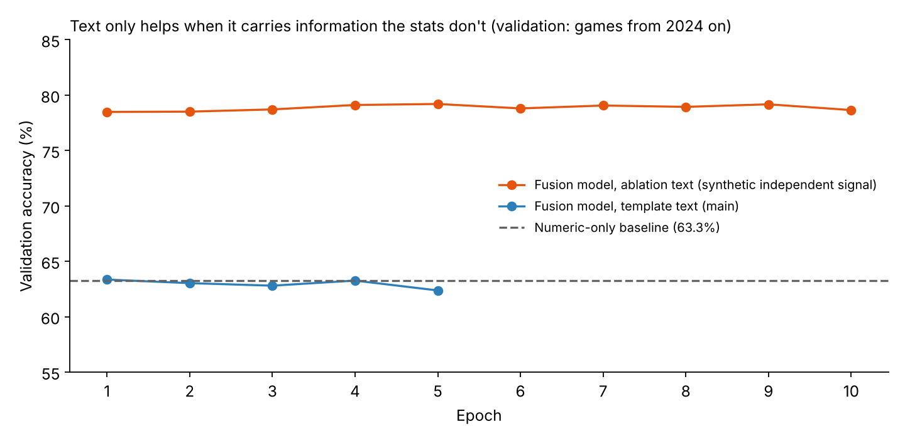
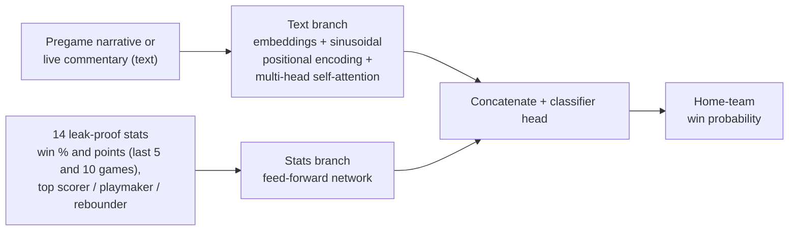

# NBA Win Market: Can Language Move the Odds?

**A PyTorch dual-branch model that predicts NBA win probability from team statistics *and* natural-language commentary, plus a live Streamlit demo where typed-in game events shift the odds.**

The question: team stats give a solid baseline, but injuries, ejections and hot streaks show up first as *language*. Can a Transformer text encoder add signal the numbers don't have?

Columbia University APAN 5910 Applied Deep Learning and AI, Summer 2026 (individual project).

## Results at a glance

| Model | Validation accuracy (games from 2024 on) |
| --- | --- |
| Numeric-only logistic regression baseline | 63.3% |
| Dual-branch fusion, template pregame text (main) | 62.4–63.4% across epochs |
| Dual-branch fusion, ablation text with independent signal (+ GloVe) | **79.2%** (best epoch) |



**What this shows:**
- **The main model only matches the baseline, and that's the expected, honest result.** Its pregame text is generated from the same statistics, so the network reads the same information twice.
- **The ablation is a capacity test, not a real-world accuracy claim.** Its synthetic "surprise" phrases (severe injuries, lineup changes) were deliberately built to contradict the statistical favorite in upsets. It shows the architecture *can* pick up game-changing information from text when that information exists. Validating this on real commentary is the next step.

## Architecture



- **Text branch:** a custom Transformer encoder with a vocabulary of 1,495 tokens built from the project's own corpus (2,237 in the ablation, initialized with GloVe at 92.2% coverage).
- **Stats branch:** a small multilayer perceptron (MLP) over 14 numeric features for both teams.
- **Training:** Adam (learning rate 1e-3), binary cross-entropy, 32,609 training games and 3,476 validation games.

## Data pipeline

Source: [Historical NBA Data and Player Box Scores](https://www.kaggle.com/datasets/eoinamoore/historical-nba-data-and-player-box-scores) (Kaggle), downloaded with `kagglehub` inside the notebook. The data is not stored in this repo.

| Step | Detail |
| --- | --- |
| Raw tables | Games (73,279 rows), TeamStatistics (146,560), PlayerStatisticsExtended (838,803) |
| Data-quality fix | Recovered rows with a corrupted `teamId = 0` by cross-referencing home/away IDs in the Games table |
| **Leakage prevention** | Every rolling feature uses `.shift(1)` before `.rolling()`, so a game never sees its own result |
| Final table | 36,085 complete games |
| **Time-based split** | Train on games before 2024-01-01 and validate on games after, the way a real market would have to predict |

> **Data leakage, in plain words:** if a model can see any information from the game it's predicting, such as that game's final points, it looks brilliant in testing and fails in real life. Shifting features by one game and splitting by date rules that out.

## Live demo (Streamlit)

`app.py` runs in two stages:

1. **Pregame:** pick two teams. The app builds a stats-based narrative, which you can edit, and shows a calibrated pregame win probability from the trained model.
2. **Live game:** step through a simulated game, editing the score and clock, and type commentary such as "star guard leaves with an ankle injury." The probability updates by combining:
    - the trained model's pregame estimate
    - a rule-based adjustment for score and time remaining
    - a pretrained **DistilBERT** sentiment model that reads the commentary and nudges the odds toward the team it favors

The live stage is a **prototype of the idea**. The core model was not trained on real timestamped play-by-play commentary, because licensed feeds (ESPN, AP, NBA Stats API) weren't practical within the project timeline.

## How to run

This project uses [uv](https://github.com/astral-sh/uv):

```bash
uv sync                       # install dependencies (torch, transformers, streamlit, ...)
uv run streamlit run app.py   # launch the demo
```

The trained artifacts are included, so the app runs without retraining: `trained_model.pt`, `vocab.json`, `standardization_stats.json`, `calibration.json`, `latest_team_stats.csv`. To retrain from scratch, run `nba_project_clean_pipeline.ipynb`.

## Repository structure

```
├── app.py                              # Streamlit demo (pregame + live stages)
├── nba_project_clean_pipeline.ipynb    # data cleaning, features, training, ablation, export
├── trained_model.pt                    # fusion model weights
├── vocab.json, standardization_stats.json, calibration.json, latest_team_stats.csv
├── docs/validation_accuracy.png
├── pyproject.toml, uv.lock, requirements-working.txt
```

## Limitations and next steps

- **Train on real commentary:** use independently sourced play-by-play or news text to test the text branch on real-world data.
- **Richer stats branch:** add rebounds, assists and other player metrics that are already in the raw data.
- **Voice input:** stream spoken commentary from an M5Stack Core2 through AWS IoT Core into a transcription service, building on my [AIoT project](https://github.com/Darrenlinnn/meeting-audio-interaction-tracker).

**Tools:** PyTorch (custom Transformer, multi-branch fusion), Hugging Face Transformers (DistilBERT), GloVe embeddings, pandas, scikit-learn, Streamlit, Altair, uv
